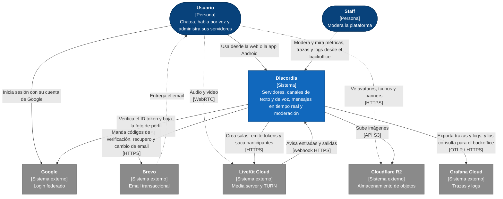
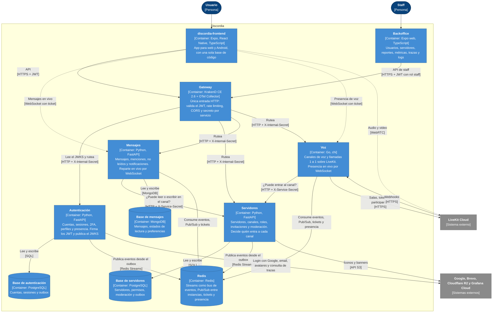
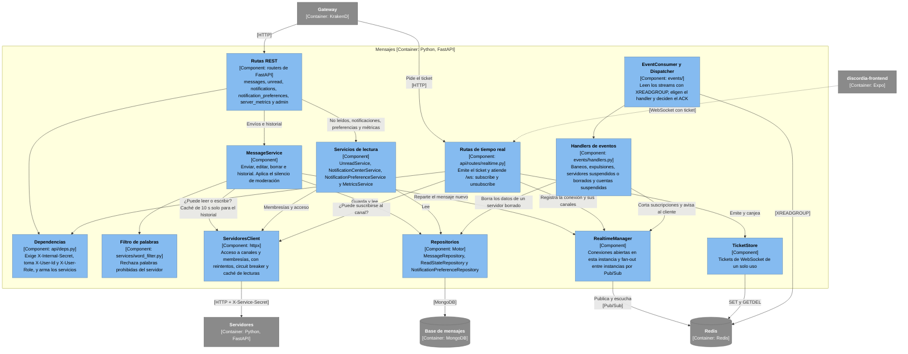
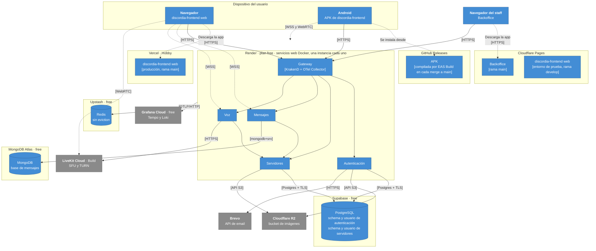

# Diagramas C4

La arquitectura de Discordia en los niveles del [modelo C4](https://c4model.com/): contexto, contenedores y componentes de un servicio (mensajes), más el diagrama complementario de deployment. Cada flecha sale del código de `main` de cada repo (25/11/2026), no del plan inicial.

Están en Mermaid para que GitHub los muestre sin descargar nada y para que un cambio se revise como texto en el PR. Cada caja dice qué es, entre corchetes su tipo y tecnología, y qué hace. Cada flecha dice qué pasa y, entre corchetes, el protocolo.

| Color | Qué es |
|---|---|
| Azul oscuro | Persona |
| Azul | Discordia, o un contenedor o componente propio |
| Celeste | Componente (solo en el nivel 3) |
| Gris | Sistema o contenedor externo, que no es de Discordia o no se describe en ese nivel |

Las flechas punteadas son conexiones directas que **no pasan por el gateway**: WebSocket, WebRTC y la descarga de los frontends.

## 1. Contexto

Quién usa Discordia y con qué sistemas externos habla.

- **El audio y el video no pasan por Discordia:** el cliente se conecta a LiveKit Cloud con un token que emite voz ([ADR 0002](../adr/0002-voz-con-livekit.md)).
- **Las imágenes tampoco:** Discordia las sube a R2 y guarda solo la URL pública, que el cliente pide directo.
- **El backoffice no habla con Grafana:** consulta trazas y logs a través de autenticación ([ADR 0013](../adr/0013-observabilidad-en-el-backoffice.md)).

## 2. Contenedores

Qué hay adentro de Discordia: dos frontends, el gateway, cuatro servicios, sus bases y Redis.

- **Todo el HTTP pasa por el gateway** ([ADR 0014](../adr/0014-api-gateway-con-krakend.md)). El gateway valida el JWT contra el JWKS de autenticación y pasa `X-User-Id` y `X-User-Role` a cada servicio, que rechaza cualquier request sin su `X-Internal-Secret`.
- **El WebSocket va directo al servicio,** con un ticket de un solo uso que el cliente pide por el gateway ([ADR 0006](../adr/0006-tiempo-real-websocket-por-servicio.md)).
- **Las únicas llamadas síncronas entre servicios** son las de mensajes y voz a servidores, para saber si alguien puede entrar a un canal ([ADR 0003](../adr/0003-voz-consulta-sincrona-a-servidores.md)). Autenticación y servidores no llaman a ningún otro servicio.
- **Lo demás va por eventos:** autenticación y servidores los publican desde su outbox, y mensajes y voz los consumen ([ADR 0001](../adr/0001-bus-de-eventos-redis-streams.md), [`eventos.md`](../eventos.md)).
- **Una base por servicio:** voz no tiene, porque LiveKit es la fuente de verdad de quién está en cada sala ([ADR 0004](../adr/0004-voz-sin-base-de-datos.md)). Redis no es la base de ningún servicio ([ADR 0015](../adr/0015-lenguajes-y-bases-de-datos.md)).
- **Observabilidad:** los cuatro servicios exportan trazas y logs por OTLP a Grafana Cloud, y el gateway lo hace a través del collector de su contenedor ([ADR 0008](../adr/0008-trazabilidad-con-opentelemetry-y-grafana-cloud.md)). No se dibuja para no cruzar el diagrama con cinco flechas iguales.

## 3. Componentes de mensajes

Cómo está armado mensajes por dentro. Cada componente es un módulo de `app/` en el repo `microservicio-mensajes`.

- **Un mensaje nuevo:** la ruta llama a `MessageService`. El servicio pregunta a servidores si el autor puede escribir, sin caché, para que un baneo o un silencio apliquen enseguida. Después pasa el filtro de palabras, guarda en Mongo y le pasa el mensaje a `RealtimeManager`, que lo publica en Redis Pub/Sub. Cada instancia lo recibe y lo manda a sus conexiones suscriptas a ese canal ([ADR 0009](../adr/0009-tiempo-real-de-mensajes.md)).
- **El historial tolera un servidores lento:** su consulta de acceso usa un caché de 10 s y un presupuesto de tiempo menor. Enviar, editar, borrar y suscribirse preguntan siempre. Si servidores falla varias veces seguidas, el circuit breaker corta las llamadas por 30 s y mensajes responde `503`.
- **Los eventos no pasan por las rutas:** el consumidor corre como tarea de fondo del mismo proceso y los handlers actúan sobre el `RealtimeManager` y los repositorios.
- **Lo transversal** (configuración, logs JSON, `request_id` y OpenTelemetry, en `app/core/`) lo usan todos los componentes y no se dibuja.

## 4. Deployment

Dónde corre cada contenedor en producción. La justificación de cada proveedor y las alternativas descartadas están en el [ADR 0016](../adr/0016-despliegue-en-la-nube.md).

- **CD:** cada merge a `main` despliega solo. Render espera a que pase el CI del repo antes de desplegar cada servicio. Vercel, Cloudflare Pages y EAS construyen cada uno lo suyo. El detalle por pieza está en el ADR 0016.
- **Una instancia por servicio,** porque las migraciones de autenticación y servidores corren al arrancar. Por eso el fan-out entre instancias de mensajes y voz no se ejerce en producción, aunque está implementado y probado en las [pruebas de carga](../pruebas/carga/informe.md).
- **Un solo proyecto de Supabase** para las dos bases relacionales, aisladas por schema y usuario.
- **Las flechas `[rediss://]` y `[OTLP/HTTP]` salen del grupo Render** porque las usan varios servicios: Redis lo usan los cuatro y Grafana, los cinco contenedores.
